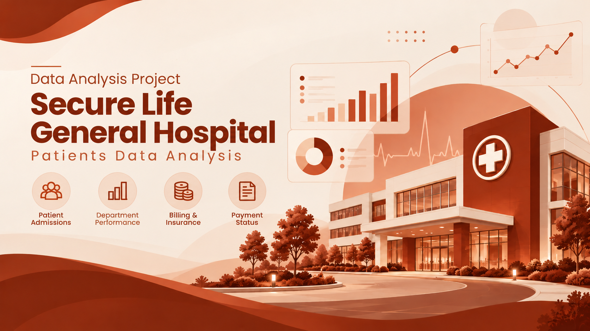
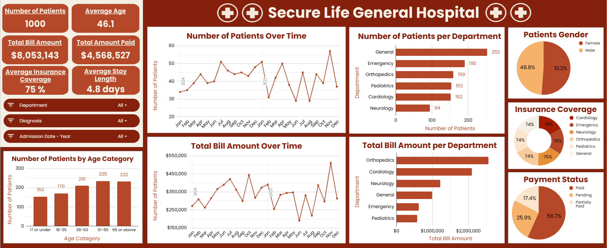

# Secure Life General Hospital Patients Data Analysis

## Introduction

Healthcare organizations need accurate data to make better decisions, improve patient care, and manage their resources effectively. This project focuses on analyzing patient records from the **Secure Life General Hospital dataset** to extract meaningful insights into patient admissions, department performance, medical billing, insurance coverage, and payment status. **Google Sheets** was used to analyze the dataset, create **Pivot Tables** to summarize the data, and build a **dashboard** to visualize the key findings in a clear and easy-to-understand way.

## About the Dataset

The dataset contains **1,000 patient visit records** from January 2024 to December 2025. Each row represents a patient visit, meaning that the same patient may appear more than once.

The dataset contains **11 columns**:

| Column | Description |
|---|---|
| Patient ID | Unique identification number assigned to each patient visit or record |
| Patient Name | Name of the patient |
| Age | Patient's age in years |
| Gender | Patient's gender |
| Admission Date | Date the patient was admitted to the hospital |
| Discharge Date | Date the patient was discharged from the hospital |
| Department | Hospital department responsible for the patient's treatment |
| Diagnosis | Patient's recorded medical condition |
| Total Bill Amount | Total amount charged for the patient's medical services |
| Insurance Coverage (%) | Percentage of the bill covered by the patient's health insurance |
| Payment Status | Indicates whether the patient's bill is Paid, Pending or Partially Paid |

The dataset covers **six departments**:

- General
- Emergency
- Orthopedics
- Pediatrics
- Cardiology
- Neurology

## Problem Statement

Analyzing hospital data involves more than just looking at individual patient records. The main challenge in this project was to turn raw patient data into useful information that could answer important questions, such as:

- Which departments handle the highest number of patients?
- How are medical bills and payments distributed?
- Are patient admissions increasing or decreasing over time?
- How does the average length of stay differ between departments?

By exploring these areas, the analysis aims to highlight important trends, identify possible issues, and provide insights that can support better planning and decision-making.

## Visualization

The dashboard provides an overview of the hospital's operational and financial performance through **6 KPI cards** highlighting the main hospital metrics and **8 charts** covering patient admissions and demographics, department performance, billing trends, insurance coverage, and payment status. It also includes **3 slicers** to filter the data by Department, Diagnosis, and Admission Year.

## Insights

### 1. Admission and Billing Trends

The hospital recorded **1,000 patient visits** between January 2024 and December 2025. There was a small decrease in patient visits from 2024 to 2025.

- **2024:** 508 visits
- **2025:** 492 visits

The hospital generated a total billed amount of **$8,053,143**.

**November 2025** recorded:

- The highest monthly number of visits: **57**
- The highest monthly billed amount: **$510,414**

### 2. Patient Demographics

The average patient age is approximately **46.1 years**. The age group with the highest number of visits is 51–65 years.

The gender distribution is relatively balanced:

- **Female:** 51.2%
- **Male:** 48.8%

### 3. Department Performance

#### 3.1. Number of Patients

The General Department recorded the highest number of patient visits, with 252 visits, followed by Emergency at 190 visits, while the Neurology Department recorded the lowest, with 94 visits.

#### 3.2. Total Bill Amount

The Orthopedics Department generated the highest total bill amount at $2,553,862, followed by Cardiology at $2,095,437, while Pediatrics recorded the lowest at $572,988.

#### 3.3. Average Length of Stay

The overall average length of stay is approximately **4.8 days**.

Orthopedics has the longest average length of stay, while Emergency has the shortest.

| Department | Average Length of Stay |
|---|---:|
| Orthopedics | 8.4 days |
| Neurology | 6.9 days |
| Cardiology | 6.5 days |
| General | 3.9 days |
| Pediatrics | 3.0 days |
| Emergency | 2.0 days |

### 4. Payment Status

The payment status analysis shows:

| Payment Status | Percentage of Total Bill Amount |
|---|---:|
| Paid | 56.7% |
| Pending | 25.9% |
| Partially Paid | 17.4% |

The total billed amount associated with records marked Paid is **$4,568,527**.

Bills marked Pending or Partially Paid account for **$3,484,616** in total billed charges.

### 5. Average Insurance Coverage

The overall average insurance coverage is approximately **75%**.

Coverage is fairly balanced across all departments, ranging from 74% to 76%, with no major differences between them.

## Recommendations

Based on the analysis, the following recommendations can help improve the hospital's performance:

1. **Monitor Patient Admissions:** Management should investigate the reasons behind the decrease in patient visits from 2024 to 2025 and take appropriate action if needed.

2. **Improve Staff Allocation:** The General and Emergency departments have the highest numbers of patient visits. Management should review staffing levels and consider increasing staff in these departments to handle patient demand more efficiently.

3. **Reduce Pending Payments:** Management should follow up on pending and partially paid bills to reduce unpaid balances and improve payment collection.

4. **Review Length of Stay:** Orthopedics has the highest average length of stay. Management should investigate the reasons behind longer stays and look for ways to reduce unnecessary delays without affecting patient care.

## Conclusion

This project shows how data analysis can turn raw hospital patient data into useful insights. By analyzing patient admissions, department performance, billing, insurance coverage, and payment status, several important patterns and areas for improvement were identified. The dashboard provides a clear overview of the hospital's operational and financial performance, making it easier to understand trends and compare results across departments. Overall, the analysis highlights how data can support better decision-making, improve resource planning, and help identify areas that need attention.

## Project Files

`README.md` — Project documentation and findings

`Introductory_Image.png` — Healthcare-themed project cover

`Dashboard_Image.png` — Screenshot of the completed dashboard

`Hospital_Patients_Dataset.xlsx` — Original hospital patients dataset

`Hospital_Patients_Data_Analysis.xlsx` — Completed Google Sheets analysis, including calculations, Pivot Tables, and the dashboard
